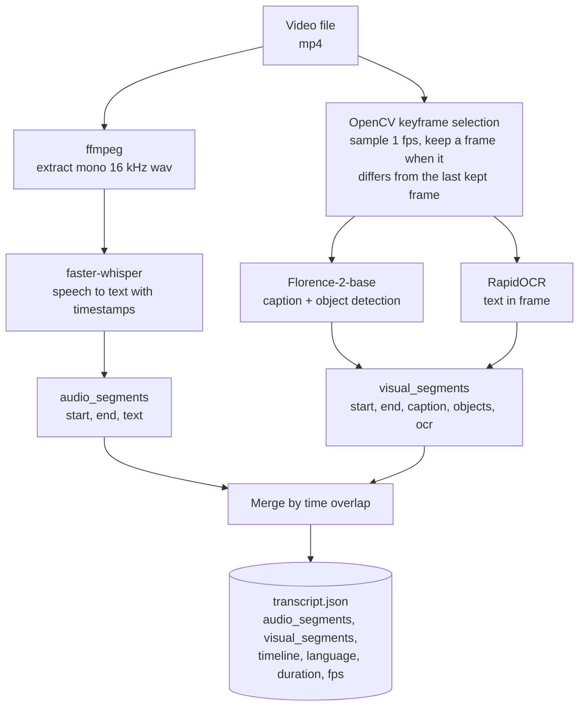
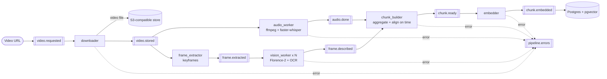
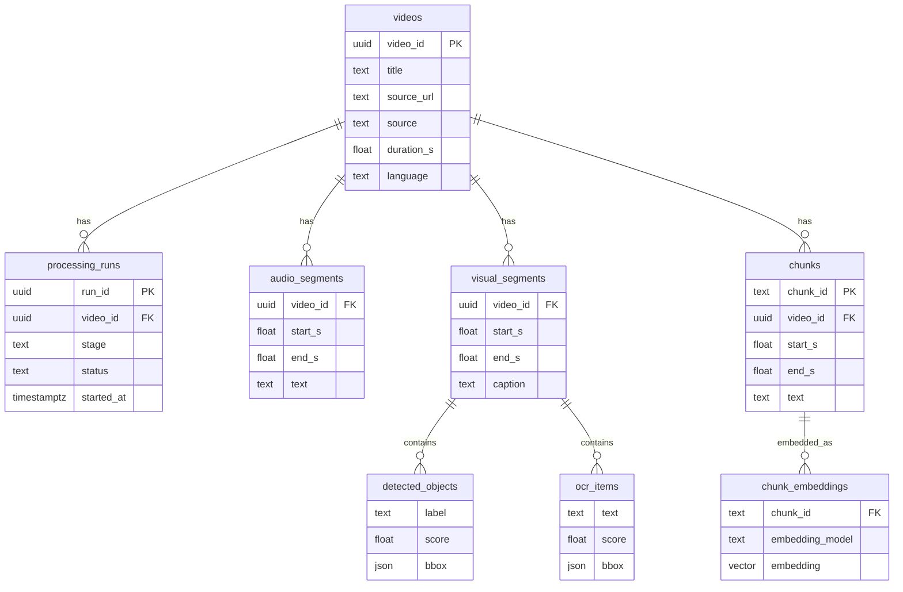
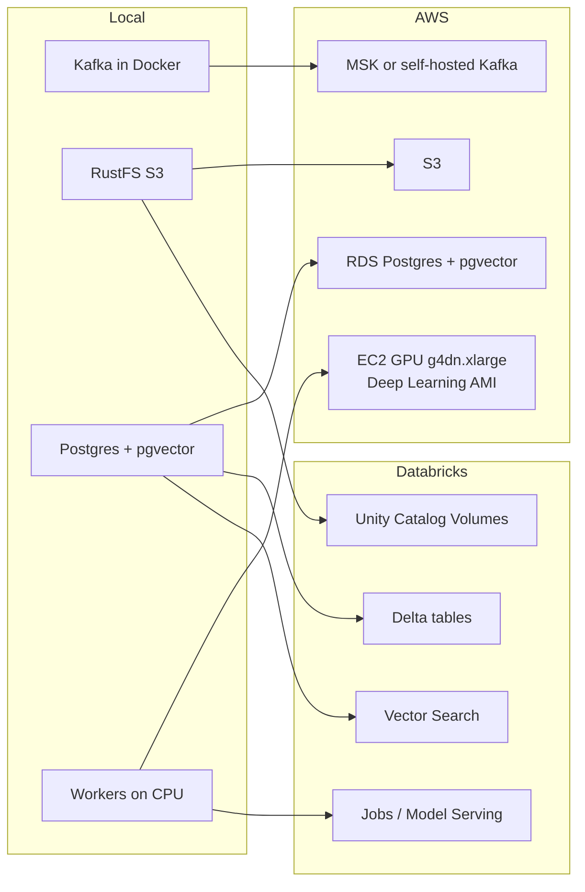

# Video Analytics Platform

A data-engineering project that turns a video into searchable, structured text: what is **said** (speech transcription), what is **shown** (scene captions, detected objects) and what is **written** on screen (OCR), all aligned on one timeline.

> **Portfolio project, not a product.**
> This repository exists to demonstrate data-engineering skills. It is non-commercial. Some of the videos used for testing come from sources whose licence terms for commercial use are unclear, so **no media files are included or redistributed** (they are git-ignored), and the outputs should not be used commercially. Only a small sample transcript JSON is committed. If you run the project, use media you have the right to use.

## Table of contents

1. [The idea](#the-idea)
2. [Current state](#current-state)
3. [How extraction works (notebook stage)](#how-extraction-works-notebook-stage)
4. [Target architecture (Kafka pipeline)](#target-architecture-kafka-pipeline)
5. [Data model](#data-model)
6. [Scaling design](#scaling-design)
7. [Cloud expansion](#cloud-expansion)
8. [Repository layout](#repository-layout)
9. [Getting started](#getting-started)
10. [Known constraints](#known-constraints)
11. [Roadmap](#roadmap)

## The idea

A video carries information in three channels, and each needs a different tool:

| Channel | Question | Tool |
| --- | --- | --- |
| Audio | What is being said, and when? | [faster-whisper](https://github.com/SYSTRAN/faster-whisper) (`small`, int8, CPU) |
| Visuals | What is on screen, and when does it change? | Florence-2-base (caption + object detection) on selected keyframes |
| On-screen text | What is written in the frame? | [RapidOCR](https://github.com/RapidAI/RapidOCR) (ONNX runtime) |

The result is a single timestamped JSON per video (audio segments, visual segments, and a merged timeline). That output is the raw material for the data-engineering part: chunking, embeddings, vector search and a queryable store.

Design choice: everything is **CPU-friendly and lightweight** so it runs on a laptop or a small VM. GPU is an optional later optimisation, not a requirement.

## Current state

| Area | Status |
| --- | --- |
| Audio transcription notebook (faster-whisper) | Working |
| Single-image CV + OCR notebook | Working |
| Video notebook: audio + keyframe visuals + OCR, merged timeline JSON | Working |
| Video download (yt-dlp) in the setup notebook | Working |
| Local infra definition (Kafka, S3-compatible store, Postgres + pgvector via Docker Compose) | Written |
| Topic config + idempotent topic-creation script | Written |
| Message schemas, Postgres/S3/Kafka helpers, quality checks (`src/vidpipe`) | Written, unit-tested |
| Downloader and audio workers, `submit_video.py` | Written |
| Frame extractor and vision worker (Florence-2 + OCR) | Written, tests pass; not yet run end to end |
| Chunk builder (time-window chunks of speech, scene and on-screen text) | Written, tests pass; not yet run end to end |
| Embedder, summarizer | Folder skeleton only |
| Postgres schema | DDL written for `videos`, `processing_runs`, audio, visual and chunk tables (with views for segment end times and per-video progress); embeddings designed |
| Cloud (AWS / Databricks) | Planned, nothing built |

The notebooks are the proof of the extraction logic. The Kafka services are the next step: moving the same logic into independent, scalable workers.

## How extraction works (notebook stage)

`local/demo/video/video_processing.ipynb` runs two independent branches and merges them by time overlap.



Why keyframes instead of every frame: running a vision model on all frames is wasteful, since most consecutive frames are near-identical. Frames are sampled at 1 fps and a frame is kept only when it differs enough from the last kept one (downscaled grayscale diff, threshold 8). Each visual segment lasts from its keyframe until the next one.

## Target architecture (Kafka pipeline)

The notebooks are sequential and single-process. The target is an event-driven pipeline where each stage is a worker that reads one topic and writes the next. Messages carry **storage URIs, not payloads**, so large files stay in object storage.



### Design decisions

- **Persistent, generically named topics** (`video.requested`, `chunk.ready`, ...), not one set of topics per run. A video is identified by the message key (`video_id`) and the message envelope. Topics are created by a script (`local/scripts/create_topics.py`) from `local/config/pipeline.yaml`, not by Docker Compose, so the topic set is versioned config and auto-creation is disabled (a typo in a topic name fails instead of silently creating a new topic).
- **Key by `video_id`** so all messages of one video stay ordered within a partition. The frame topics key by `video_id + frame_idx` to spread frames across workers.
- **Idempotent consumers**: every write is an upsert on a deterministic ID, so a redelivered message cannot create duplicates (Kafka is at-least-once).
- **Out-of-order tolerant**: parallel workers finish in any order. Workers emit only a `start_s`; the aggregator derives each segment's end from the next start.
- **Dead-letter topic** (`pipeline.errors`) with an envelope that records the failed stage, original message and error, so failures are inspectable and replayable.
- **Swappable models**: transcription, vision and embedding models sit behind small interfaces (planned in `src/vidpipe`), and the embedding model name is stored with each vector.
- **`max.poll.records=1`** for the heavy workers so one slow frame does not hold back a large batch.

## Data model

Planned Postgres schema. Vectors live in their own table so the embedding model can change without touching the metadata.



Videos have no universal field set, so the `videos` table keeps general metadata (name, source, link, duration, language) and the content-specific detail lives in the segment tables. `chunk_id` is deterministic (derived from `video_id` and the time range), which makes re-runs idempotent. If pgvector becomes a limit, the same layout migrates to Qdrant by moving only `chunk_embeddings`.

## Scaling design

Scaling is by **consumer groups and partitions**: run more copies of a worker and Kafka spreads partitions across them.

- The slow stage is vision (one model call per keyframe), so `frame.extracted` and `frame.described` have 6 partitions, which caps parallel vision workers at 6. The other topics have 3.
- Workers are stateless and read inputs from object storage, so they can run on any machine.
- Local development runs the same code with one worker per stage on a single broker (replication factor 1).
- For a long video (for example a 2-hour talk), the first levers are fewer frames (a higher diff threshold or a lower sample rate) and a GPU, before adding more workers. Spark was evaluated and is **not** planned for now: the workload is a per-frame model call, which worker pods handle more simply. It can be revisited for very large batches.

## Cloud expansion

The local stack maps one-to-one onto managed services, so the pipeline code should not change, only configuration (endpoints and credentials).



### AWS plan

- **Compute**: an EC2 GPU instance (g4dn.xlarge, Deep Learning AMI) for the vision and Whisper workers. It is started for a batch and terminated after, since a GPU is only worth paying for while it works.
- **Storage**: S3 replaces the local RustFS store. The code already talks the S3 API, so this is an endpoint change.
- **Infrastructure as code**: Terraform with two stacks. A *persistent* stack (S3, networking, IAM, database) and an *ephemeral* stack (the GPU instance) that can be applied and destroyed per run, with an auto-terminate safeguard.
- **Access**: SSM Session Manager instead of open SSH ports.
- **Prerequisite**: a GPU instance vCPU quota increase request.

### Databricks plan

- Raw video and audio in Unity Catalog Volumes; segments and chunks as Delta tables; embeddings served through Databricks Vector Search.
- The Free Edition is serverless with limits (GPU availability and Vector Search endpoints are restricted), so it suits the storage and SQL parts better than model inference.
- Shared logic (for example a `FrameDescriber` class) is written once and used by both the Kafka worker and a Spark `mapInPandas` variant, if Spark is ever adopted.

## Repository layout

```
.
├── README.md
├── pyproject.toml
├── src/vidpipe/                 # shared pipeline code: message schemas, Kafka/S3/Postgres helpers, quality checks
└── local/                       # everything that runs on a laptop or VM
    ├── config/pipeline.yaml     # Kafka bootstrap + topic definitions
    ├── infra/
    │   ├── docker-compose.yml   # Kafka (KRaft), Kafka UI, RustFS (S3), Postgres + pgvector
    │   └── .env.example
    ├── scripts/create_topics.py # idempotent topic create/update
    ├── scripts/submit_video.py  # entry point: publish a URL or file to video.requested
    ├── scripts/apply_sql.py     # apply sql/*.sql to an existing database
    ├── scripts/init_storage.py  # idempotent bucket creation
    ├── services/                # one folder per worker (skeleton)
    │   ├── downloader/  audio_worker/  frame_extractor/
    │   └── vision_worker/  chunk_builder/  embedder/  summarizer/
    ├── sql/                     # schema DDL, run on first Postgres start
    ├── tests/                   # unit tests and DB idempotency tests
    ├── demo/                    # the notebook experiments
    │   ├── Setup.ipynb          # env checks + sample downloads
    │   ├── audio/transcript.ipynb
    │   ├── image/image_process.ipynb
    │   └── video/video_processing.ipynb
    ├── requirements.txt
    └── ssl.env.example          # optional CA bundle paths
```

Media under `local/demo/**/data/` is git-ignored. Only the `.gitkeep` placeholders and one sample transcript JSON are tracked.

## Getting started

Python 3.10 is recommended. A release-candidate Python 3.11 breaks `transformers`.

```bash
cd local
python3.10 -m venv .env
source .env/bin/activate
pip install -r requirements.txt
```

Then open `local/demo/Setup.ipynb` to download sample media, and run the notebooks under `local/demo/`. The first run downloads the Whisper and Florence-2 models.

Local infrastructure:

```bash
cd local/infra
cp .env.example .env
docker compose up -d
cd ..
python scripts/create_topics.py --dry-run   # preview
python scripts/create_topics.py             # apply
python scripts/init_storage.py              # create the bucket
```

Kafka UI is at http://localhost:8080 and the object-store console at http://localhost:9001.

Run the pipeline (the downloader and audio worker), from `local/`, each in its own terminal:

```bash
pip install -e ..                           # once: makes the shared `vidpipe` package importable
python scripts/apply_sql.py                 # create the tables (skip if the volume was just created)

python -m services.downloader.worker        # terminal 1
python -m services.audio_worker.worker      # terminal 2
python -m services.frame_extractor.worker   # terminal 3
python -m services.vision_worker.worker     # terminal 4 (start more copies to go faster)
python -m services.chunk_builder.worker     # terminal 5

python scripts/submit_video.py "<video url>"            # terminal 6: submit a URL
python scripts/submit_video.py --file path/to/video.mp4  # or a local file
```

Check the result in Postgres:

```sql
SELECT start_s, end_s, text FROM audio_segments WHERE video_id = '<video_id>' ORDER BY start_s;
SELECT stage, status, attempts, error FROM processing_runs WHERE video_id = '<video_id>';

-- what is on screen, with derived end times, and how far the video has got
SELECT start_s, end_s, caption FROM visual_segments_timed WHERE video_id = '<video_id>' ORDER BY start_s;
SELECT * FROM video_progress WHERE video_id = '<video_id>';   -- frames_described should reach keyframe_count

-- the chunks that will be embedded: speech + scene + on-screen text per time window
SELECT chunk_idx, start_s, end_s, text FROM chunks WHERE video_id = '<video_id>' ORDER BY chunk_idx;
```

Failures land on the `pipeline.errors` topic (visible in Kafka UI) and as a `failed` row in `processing_runs`. Tests: `pytest` from `local/` (the database tests are skipped when Postgres is not running).

## Known constraints

- **CPU only**, which keeps it portable but slow for long videos. GPU work is planned on AWS.
- **YouTube downloads** need a JavaScript runtime (Deno 2+ or Node 20+) and `yt-dlp[default]`.
- **Florence-2 pins**: `transformers==4.49.0`, `trust_remote_code`, eager attention, `use_cache=False`.

## Roadmap

1. Bring up the local stack and create the topics.
2. Define the message envelope and schemas in `src/vidpipe/schemas`.
3. Run the downloader, audio, frame extractor and vision workers end to end and record a scaling benchmark (1 versus N vision workers).
4. Embedder (try one embedding model first) and the embeddings table.
5. Search over chunks (semantic query returning video, timestamp and text).
6. Terraform for the AWS GPU stack; Databricks storage and vector search.
