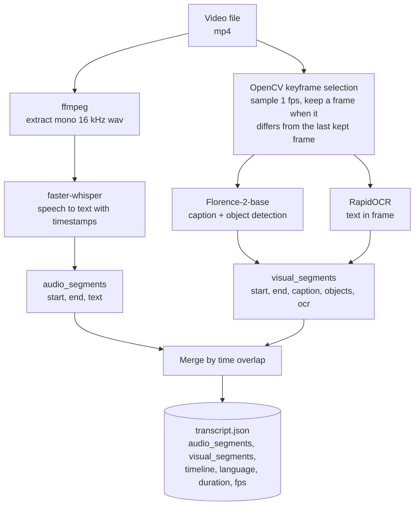
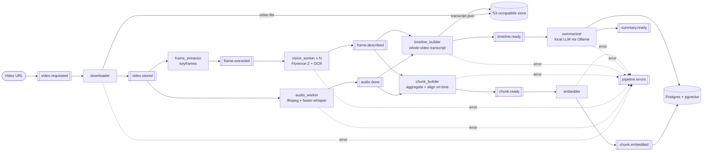
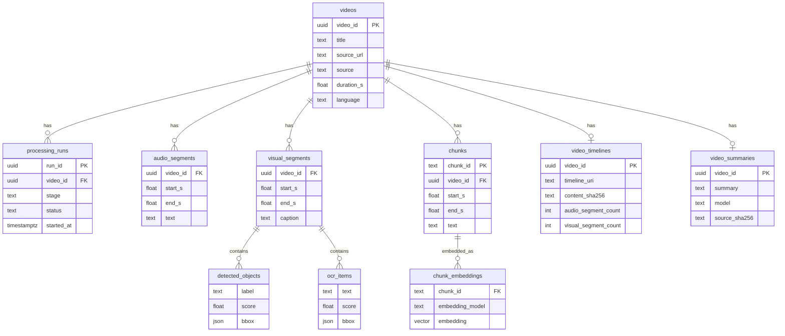
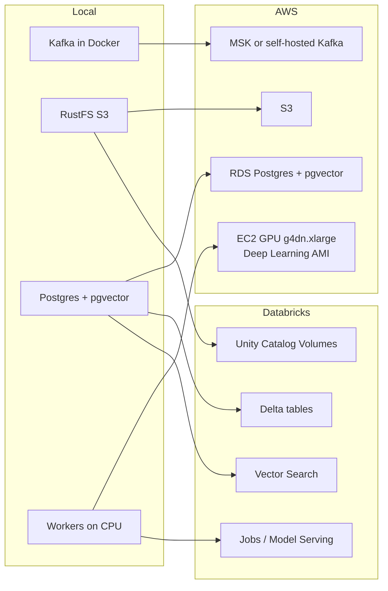

# Video Analytics Platform

A data-engineering project that turns a video into searchable, structured text: what is **said** (speech transcription), what is **shown** (scene captions, detected objects) and what is **written** on screen (OCR), all aligned on one timeline.

> **Portfolio project, not a product.**
> This repository exists to demonstrate data-engineering skills. It is non-commercial. Some of the videos used for testing come from sources whose licence terms for commercial use are unclear, so **no media files are included or redistributed** (they are git-ignored), and the outputs should not be used commercially. Only a small sample transcript JSON is committed. If you run the project, use media you have the right to use.

## Table of contents

1. [The idea](#the-idea)
2. [Current state](#current-state)
3. [How extraction works (notebook stage)](#how-extraction-works-notebook-stage)
4. [Target architecture (Kafka pipeline)](#target-architecture-kafka-pipeline)
5. [Data model](#data-model)
6. [Scaling design](#scaling-design)
7. [Cloud expansion](#cloud-expansion)
8. [Repository layout](#repository-layout)
9. [Getting started](#getting-started)
10. [Known constraints](#known-constraints)
11. [Roadmap](#roadmap)

## The idea

A video carries information in three channels, and each needs a different tool:

| Channel | Question | Tool |
| --- | --- | --- |
| Audio | What is being said, and when? | [faster-whisper](https://github.com/SYSTRAN/faster-whisper) (`small`, int8, CPU) |
| Visuals | What is on screen, and when does it change? | Florence-2-base (caption + object detection) on selected keyframes |
| On-screen text | What is written in the frame? | [RapidOCR](https://github.com/RapidAI/RapidOCR) (ONNX runtime) |

The result is a single timestamped JSON per video (audio segments, visual segments, and a merged timeline). That output is the raw material for the data-engineering part: chunking, embeddings, vector search and a queryable store.

Design choice: everything is **CPU-friendly and lightweight** so it runs on a laptop or a small VM. GPU is an optional later optimisation, not a requirement.

## Current state

| Area | Status |
| --- | --- |
| Audio transcription notebook (faster-whisper) | Working |
| Single-image CV + OCR notebook | Working |
| Video notebook: audio + keyframe visuals + OCR, merged timeline JSON | Working |
| Video download (yt-dlp) in the setup notebook | Working |
| Local infra definition (Kafka, S3-compatible store, Postgres + pgvector via Docker Compose) | Written |
| Topic config + idempotent topic-creation script | Written |
| Message schemas, Postgres/S3/Kafka helpers, quality checks (`src/vidpipe`) | Written, unit-tested |
| Downloader and audio workers, `submit_video.py` | Written |
| Frame extractor and vision worker (Florence-2 + OCR) | Written, tests pass; not yet run end to end |
| Chunk builder (time-window chunks of speech, scene and on-screen text) | Written, tests pass; not yet run end to end |
| Timeline builder (whole-video transcript JSON, same shape as the notebook output) | Written, tests pass; not yet run end to end |
| Summarizer (local LLM through Ollama: short summary with key moments, from the transcript) | Written, tests pass with a fake LLM; not yet run with a real model |
| Embedder (sentence-transformers, default `BAAI/bge-small-en-v1.5`: one vector per chunk in pgvector) and the `scripts/search.py` semantic search | Written; unit tests pass, the database tests and the SQL have not been run against pgvector yet; not run end to end |
| Postgres schema | DDL written for `videos`, `processing_runs`, audio, visual, chunk, timeline and embedding tables (with views for segment end times and per-video progress) |
| Cloud: Databricks (`clouds/databricks/`) | Terraform, upload script and notebooks 01 and 02 (keyframes, Whisper, Florence-2, OCR) written; notebook 01 run on Free Edition, 02 being run; notebooks 03 and 04 (chunks, transcript JSON) written, not yet run; embeddings and jobs not yet |
| Cloud: AWS (`clouds/aws/`) | Planned, folder empty |

The notebooks are the proof of the extraction logic. The Kafka services are the next step: moving the same logic into independent, scalable workers.

## How extraction works (notebook stage)

`local/demo/video/video_processing.ipynb` runs two independent branches and merges them by time overlap.



Why keyframes instead of every frame: running a vision model on all frames is wasteful, since most consecutive frames are near-identical. Frames are sampled at 1 fps and a frame is kept only when it differs enough from the last kept one (downscaled grayscale diff, threshold 8). Each visual segment lasts from its keyframe until the next one.

## Target architecture (Kafka pipeline)

The notebooks are sequential and single-process. The target is an event-driven pipeline where each stage is a worker that reads one topic and writes the next. Messages carry **storage URIs, not payloads**, so large files stay in object storage.



### Two parallel outputs

Once a video is complete (audio finished, keyframes extracted, every keyframe described), two independent workers read the same results from Postgres, each in its own consumer group:

| Output | Worker | Shape | Purpose |
| --- | --- | --- | --- |
| **Transcript** | `timeline_builder` | One JSON per video in object storage (`timeline/<video_id>/transcript.json`): `audio_segments`, `visual_segments` (caption, objects, OCR), and a merged `timeline` of speech, caption and on-screen text per keyframe. Same shape as the notebook output. | Reading what happens in the video, start to end |
| **Chunks** | `chunk_builder` | 45 s windows (10 s overlap) in the `chunks` table, each with one combined text, later embedded | Semantic search, with timestamps |

The transcript is the complete record of the video. Chunks overlap on purpose, so they are not meant to be concatenated into a transcript. Neither worker depends on the other, and a failure in one does not block the other. Both use the same completeness check (`db.is_complete`).

In the transcript's `timeline`, a sentence that spans several keyframes appears in each of their entries (the notebook behaves the same). `audio_segments` holds each sentence once.

### Short summary (local LLM)

The summarizer is a third consumer of the finished video, but it works on the transcript, not on Postgres tables. It reads `timeline.ready`, loads `transcript.json` from object storage and turns it into timestamped notes, one line per keyframe:

```
[00:00-00:15] Scene: a logo. On-screen: TED. Speech: A few years ago, I felt like I was stuck in a rut...
```

A local LLM served by [Ollama](https://ollama.com) (default `qwen2.5:3b`, a size that fits a CPU VM with a few GB of free RAM) writes a 3-5 sentence summary plus up to 5 key moments, each with its timestamp. The result goes to `video_summaries`.

- **Long videos use map-reduce.** Notes are packed into batches of `SUMMARY_BATCH_CHARS` (default 8000). If there is more than one batch, each is summarised, then the partial summaries are summarised again. The loop stops with an error if the text does not shrink, instead of calling the LLM forever.
- **The LLM call is skipped when nothing changed.** The summary stores the hash of the transcript and the model name it was made from. A redelivered message, or a rebuilt but identical transcript, does not call the model again.
- **A sentence is written once in the notes**, on the first keyframe it overlaps, so the model does not read repeated speech.
- **The model is behind one `generate(prompt, system)` method** (`vidpipe/models/llm.py`). Change `LLM_MODEL` for another Ollama model, or add a class for another runtime.
- Summaries from a 3B model can contain mistakes: it only sees machine-generated notes (speech recognition and captions), so treat it as an aid for reading, not as ground truth.

### Design decisions

- **Persistent, generically named topics** (`video.requested`, `chunk.ready`, ...), not one set of topics per run. A video is identified by the message key (`video_id`) and the message envelope. Topics are created by a script (`local/scripts/create_topics.py`) from `local/config/pipeline.yaml`, not by Docker Compose, so the topic set is versioned config and auto-creation is disabled (a typo in a topic name fails instead of silently creating a new topic).
- **Key by `video_id`** so all messages of one video stay ordered within a partition. The frame topics key by `video_id + frame_idx` to spread frames across workers.
- **Idempotent consumers**: every write is an upsert on a deterministic ID, so a redelivered message cannot create duplicates (Kafka is at-least-once).
- **Completion is read from the database, not held in a worker.** The extractor stores `keyframe_count`, the audio worker stores `audio_segment_count`, and the builders compare them with what has arrived. The builders keep no state, so they can be restarted or run twice.
- **Out-of-order tolerant**: parallel workers finish in any order. Workers emit only a `start_s`; the aggregator derives each segment's end from the next start.
- **Dead-letter topic** (`pipeline.errors`) with an envelope that records the failed stage, original message and error, so failures are inspectable and replayable.
- **Swappable models**: transcription, vision and embedding models sit behind small interfaces (`src/vidpipe/models`), and the embedding model name is stored with each vector, so vectors of several models can sit side by side and the model can change without a migration.
- **`max.poll.records=1`** for the heavy workers so one slow frame does not hold back a large batch.

## Data model

Postgres schema (`local/sql`). Vectors live in their own table so the embedding model can change without touching the metadata. In `chunk_embeddings` the key is `(chunk_id, model)` and the vector column has no fixed size; an HNSW index on a cast covers one model (the default one), and searches work without an index too.



Videos have no universal field set, so the `videos` table keeps general metadata (name, source, link, duration, language) and the content-specific detail lives in the segment tables. `chunk_id` is deterministic (derived from `video_id` and the time range), which makes re-runs idempotent. `video_timelines` only points to the transcript JSON in object storage and holds its hash, so a rebuild that produces identical output is recognised and emits no event. `video_summaries` keeps the summary text with the model and transcript hash it came from. If pgvector becomes a limit, the same layout migrates to Qdrant by moving only `chunk_embeddings`.

## Scaling design

Scaling is by **consumer groups and partitions**: run more copies of a worker and Kafka spreads partitions across them.

- The slow stage is vision (one model call per keyframe), so `frame.extracted` and `frame.described` have 6 partitions, which caps parallel vision workers at 6. The other topics have 3.
- Workers are stateless and read inputs from object storage, so they can run on any machine.
- Local development runs the same code with one worker per stage on a single broker (replication factor 1).
- For a long video (for example a 2-hour talk), the first levers are fewer frames (a higher diff threshold or a lower sample rate) and a GPU, before adding more workers. Spark was evaluated and is **not** planned for now: the workload is a per-frame model call, which worker pods handle more simply. It can be revisited for very large batches.

## Cloud expansion

The local stack maps one-to-one onto managed services, so the pipeline code should not change, only configuration (endpoints and credentials).



### AWS plan

- **Compute**: an EC2 GPU instance (g4dn.xlarge, Deep Learning AMI) for the vision and Whisper workers. It is started for a batch and terminated after, since a GPU is only worth paying for while it works.
- **Storage**: S3 replaces the local RustFS store. The code already talks the S3 API, so this is an endpoint change.
- **Infrastructure as code**: Terraform with two stacks. A *persistent* stack (S3, networking, IAM, database) and an *ephemeral* stack (the GPU instance) that can be applied and destroyed per run, with an auto-terminate safeguard.
- **Access**: SSM Session Manager instead of open SSH ports.
- **Prerequisite**: a GPU instance vCPU quota increase request.

### Databricks plan

- Built so far (see `clouds/databricks/README.md`): Terraform for the schema and volumes, an upload script, and notebooks for keyframes and for transcription plus frame description, writing Delta tables.
- Planned: raw video and audio in Unity Catalog Volumes; segments and chunks as Delta tables; embeddings served through Databricks Vector Search.
- The Free Edition is serverless with limits (GPU availability and Vector Search endpoints are restricted), so it suits the storage and SQL parts better than model inference.
- Shared logic (for example a `FrameDescriber` class) is written once and used by both the Kafka worker and a Spark `mapInPandas` variant, if Spark is ever adopted.

## Repository layout

```
.
├── README.md
├── pyproject.toml
├── src/vidpipe/                 # shared pipeline code: message schemas, Kafka/S3/Postgres helpers, quality checks
└── local/                       # everything that runs on a laptop or VM
    ├── config/pipeline.yaml     # Kafka bootstrap + topic definitions
    ├── infra/
    │   ├── docker-compose.yml   # Kafka (KRaft), Kafka UI, RustFS (S3), Postgres + pgvector
    │   └── .env.example
    ├── scripts/create_topics.py # idempotent topic create/update
    ├── scripts/submit_video.py  # entry point: publish a URL or file to video.requested
    ├── scripts/apply_sql.py     # apply sql/*.sql to an existing database
    ├── scripts/init_storage.py  # idempotent bucket creation
    ├── scripts/search.py        # semantic search over the embedded chunks
    ├── scripts/check_models.py  # check (and optionally download) the models the pipeline needs
    ├── services/                # one folder per worker 
    │   ├── downloader/  audio_worker/  frame_extractor/
    │   ├── vision_worker/  chunk_builder/  timeline_builder/
    │   ├── summarizer/
    │   └── embedder/            # chunk.ready -> vector in pgvector -> chunk.embedded
    ├── sql/                     # schema DDL, run on first Postgres start
    ├── tests/                   # unit tests and DB idempotency tests
    ├── demo/                    # the notebook experiments
    │   ├── Setup.ipynb          # env checks + sample downloads
    │   ├── audio/transcript.ipynb
    │   ├── image/image_process.ipynb
    │   └── video/video_processing.ipynb
    ├── requirements.txt
    └── ssl.env.example          # optional CA bundle paths
```

Media under `local/demo/**/data/` is git-ignored. Only the `.gitkeep` placeholders and one sample transcript JSON are tracked.

## Getting started

Python 3.10 is recommended. A release-candidate Python 3.11 breaks `transformers`.

```bash
cd local
python3.10 -m venv .env
source .env/bin/activate
pip install -r requirements.txt
pip install -e ..          # makes the shared `vidpipe` package importable (the scripts and workers need it)
```

Then open `local/demo/Setup.ipynb` to download sample media, and run the notebooks under `local/demo/`. The first run downloads the Whisper and Florence-2 models (see Models below to check or fetch them first).

### Models

The pipeline uses these models. All run on the CPU and stay on your machine once downloaded. Sizes are approximate.

| Model | Used by | Setting | Size | Where it lives | How it gets there |
|---|---|---|---|---|---|
| `Systran/faster-whisper-small` | audio worker | `WHISPER_MODEL` | ~490 MB | Hugging Face cache | downloaded on first use |
| `microsoft/Florence-2-base` | vision worker | `VISION_MODEL` | ~470 MB | Hugging Face cache | downloaded on first use |
| `BAAI/bge-small-en-v1.5` | embedder, `scripts/search.py` | `EMBED_MODEL` | ~130 MB | Hugging Face cache | downloaded on first use |
| `qwen2.5:3b` | summarizer | `LLM_MODEL` | ~2 GB | Ollama | `ollama pull qwen2.5:3b` |
| RapidOCR | vision worker | - | small | inside the pip package | nothing to download |

The Hugging Face cache is `~/.cache/huggingface` (or `HF_HOME`; in containers it is the `models` volume). Confirm what is there, from `local/`, before the first run:

```bash
python scripts/check_models.py              # report only: ok / MISSING for each model, exit code 1 if any is missing
python scripts/check_models.py --download   # fetch the missing Hugging Face models now (Ollama's model: ollama pull)
```

Downloading ahead of time avoids a long first run and shows network or certificate problems early. Behind a proxy that re-signs HTTPS, load the CA paths first (`set -a; source ssl.env; set +a`, see `ssl.env.example`). After everything is downloaded you can set `HF_HUB_OFFLINE=1` so the workers never touch the network. In containers, check the `models` volume with `docker compose --profile workers run --rm embedder python scripts/check_models.py`.

Local infrastructure:

```bash
cd local/infra
cp .env.example .env
docker compose up -d
cd ..
python scripts/create_topics.py --dry-run   # preview
python scripts/create_topics.py             # apply
python scripts/init_storage.py              # create the bucket
```

Kafka UI is at http://localhost:8080 and the object-store console at http://localhost:9001.

The summarizer needs a local LLM server. Install [Ollama](https://ollama.com/download) and pull the model once (about 2 GB):

```bash
ollama pull qwen2.5:3b          # Ollama listens on http://localhost:11434
```

Run the pipeline, from `local/`, each in its own terminal:

```bash
python scripts/apply_sql.py                 # create the tables; needed on a Postgres volume made before the embedding tables (006) existed, harmless otherwise

python -m services.downloader.worker        # terminal 1
python -m services.audio_worker.worker      # terminal 2
python -m services.frame_extractor.worker   # terminal 3
python -m services.vision_worker.worker     # terminal 4 (start more copies to go faster)
python -m services.chunk_builder.worker     # terminal 5 (chunks, for search)
python -m services.timeline_builder.worker  # terminal 6 (whole-video transcript JSON)
python -m services.summarizer.worker        # terminal 7 (short summary; needs Ollama running)
python -m services.embedder.worker          # terminal 8 (one vector per chunk, for search)

python scripts/create_topics.py             # again, if the topics were created before timeline.ready, chunk.ready or chunk.embedded existed

python scripts/submit_video.py "<video url>"            # terminal 9: submit a URL
python scripts/submit_video.py --file path/to/video.mp4  # or a local file
```

### Or run the workers in containers

The same workers can run as containers instead of one terminal each. The infrastructure still starts as before; the workers are behind a compose profile:

```bash
cd local/infra
cp .env.example .env                                  # once
docker compose --profile workers up -d --build        # infra + setup job + all workers
docker compose --profile workers up -d --scale vision-worker=3   # more vision workers
docker compose --profile workers logs -f vision-worker
docker compose --profile workers down                 # stop (the models volume is kept)

python scripts/submit_video.py "<video url>"          # from local/, on the host, as before
```

- A one-shot `init` service creates the topics and bucket and applies the SQL before any worker starts.
- Four images are built from `local/Dockerfile`: `light` (builders, summarizer), `media` (downloader, frame extractor, audio worker), `vision` (CPU) and `embed` (the embedder and the search script). The Whisper, Florence-2 and embedding models are downloaded on first use into the `models` volume, so a restart does not download them again.
- The summarizer reaches Ollama on the host, which must listen on all interfaces: `OLLAMA_HOST=0.0.0.0 ollama serve`.
- On a network that re-signs HTTPS, copy the CA certificate (a `.crt` file) into `local/ca/` before building (it is git-ignored), and set `YTDLP_NO_CERTIFI=1` in `local/infra/.env`.

Check the result in Postgres:

```sql
SELECT start_s, end_s, text FROM audio_segments WHERE video_id = '<video_id>' ORDER BY start_s;
SELECT stage, status, attempts, error FROM processing_runs WHERE video_id = '<video_id>';

-- what is on screen, with derived end times, and how far the video has got
SELECT start_s, end_s, caption FROM visual_segments_timed WHERE video_id = '<video_id>' ORDER BY start_s;
SELECT * FROM video_progress WHERE video_id = '<video_id>';   -- frames_described should reach keyframe_count

-- the whole-video transcript: where the JSON is stored (open it in the object-store console, or download it)
SELECT timeline_uri, audio_segment_count, visual_segment_count FROM video_timelines WHERE video_id = '<video_id>';

-- the short summary written by the local LLM
SELECT model, summary FROM video_summaries WHERE video_id = '<video_id>';

-- the chunks that will be embedded: speech + scene + on-screen text per time window
SELECT chunk_idx, start_s, end_s, text FROM chunks WHERE video_id = '<video_id>' ORDER BY chunk_idx;
```

Embeddings and semantic search (needs the embedder worker running; the first chunk loads the model, about 130 MB for the default):

```sql
SELECT model, dim, count(*) FROM chunk_embeddings GROUP BY model, dim;   -- one row per model; count = chunks embedded
SELECT chunks, (SELECT count(*) FROM chunk_embeddings e JOIN chunks c USING (chunk_id) WHERE c.video_id = p.video_id) AS embedded
FROM video_progress p WHERE video_id = '<video_id>';                     -- the two numbers should become equal
```

```bash
python scripts/search.py "what is said about stress at work"        # from local/: nearest chunks, with timestamps
python scripts/search.py "stress" --video <video_id> --limit 10
```

The embedder needs the `chunks` rows to exist first, so it starts producing vectors once the chunk builder has run (the video must be fully described). If `chunk_embeddings` stays empty, check, in order: the embedder terminal for errors, `check_models.py` for the model, and that `chunks` has rows for the video.

To try `BAAI/bge-m3` (1024 dimensions, larger and slower, no query prefix): set `EMBED_MODEL=BAAI/bge-m3` for the embedder and `search.py` (in `local/infra/.env` for containers), and run `check_models.py --download`. New videos are embedded with it from then on. Videos already processed are **not** embedded again automatically: the chunk builder emits `chunk.ready` only when chunks change, so re-running it on unchanged chunks does nothing. To embed an existing video with the new model, change `CHUNK_WINDOW_S` or `CHUNK_OVERLAP_S` (a new chunk version means new chunks and new events), or submit it as a new video. Search works without an index. For a large collection add an index for that model, as `006_embeddings.sql` does for the default:

```sql
CREATE INDEX IF NOT EXISTS idx_chunk_embeddings_bge_m3 ON chunk_embeddings
    USING hnsw ((embedding::vector(1024)) vector_cosine_ops) WHERE model = 'BAAI/bge-m3';
```

The query is embedded with the same model as the chunks (`EMBED_MODEL`). Changing `EMBED_MODEL` leaves the old vectors in place and embeds newly built chunks with the new model (see the note above for existing videos). With containers: `docker compose --profile workers run --rm embedder python scripts/search.py "your query"`.

Failures land on the `pipeline.errors` topic (visible in Kafka UI) and as a `failed` row in `processing_runs`. Tests: `pytest` from `local/` (the database tests are skipped when Postgres is not running).

## Known constraints

- **CPU only**, which keeps it portable but slow for long videos. GPU work is planned on AWS.
- **Memory is tight on a small VM.** Whisper, Florence-2 and the summary LLM each need RAM. Run the summarizer after the vision workers have finished, or use a smaller model (`LLM_MODEL=qwen2.5:1.5b`).
- **YouTube downloads** need a JavaScript runtime (Deno 2+ or Node 20+) and `yt-dlp[default]`.
- **Florence-2 pins**: `transformers==4.49.0`, `trust_remote_code`, eager attention, `use_cache=False`.

## Roadmap

1. Bring up the local stack and create the topics.
2. Define the message envelope and schemas in `src/vidpipe/schemas`.
3. Run the downloader, audio, frame extractor, vision, chunk, timeline and summarizer workers end to end and record a scaling benchmark (1 versus N vision workers).
4. ~~Embedder and the embeddings table~~ written; run it end to end and compare embedding models (bge-small versus bge-m3).
5. ~~Search over chunks~~ `scripts/search.py` written; judge the result quality on real videos.
6. Databricks: Terraform, upload script and notebooks 01 to 04 written (01 run, 02 being run); embeddings and a job still to do. AWS: Terraform for the GPU stack and the scaling work (the reason for moving on, since Free Edition is quota-limited).
